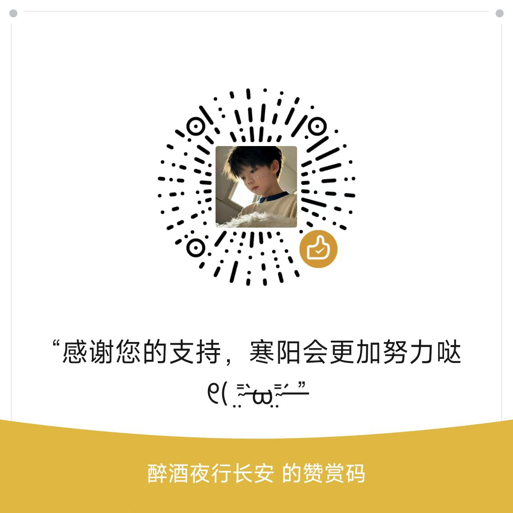

# OneTeam 团队管理系统（nteam）

> **项目声明**：本项目基于已停止维护的 **CoCo-Team 团队管理项目** 二次开发而来。原项目已停止更新维护，本项目在其基础上进行了大量重构、功能增强与安全修复，持续维护中。原项目版权归原作者所有，如有侵权请联系，我们将及时处理。

一套开箱即用的团队建站与管理系统：官网展示（首页 / 作品 / 动态 / 成员 / 留言）+ 用户中心 + 订单支付 + 完整后台。PHP + MySQL，自带网页安装向导，一条命令的门槛都不需要。

## 功能

**前台**
- 团队官网：首页、作品列表 / 详情、动态资讯、团队成员、关于、留言
- 响应式布局，移动端自适配（含移动首页与独立页脚样式）
- 用户中心：注册 / 登录、个人资料、我的订单
- 在线支付下单（彩虹易支付协议，微信 / 支付宝双渠道开关）
- 可选极验行为验证码（登录 / 注册）

**后台（Admin）**
- 站点配置：名称、Logo、备案号、页脚、SEO、公告
- 模块配置：首页 / 关于 / 作品 / 成员 等各版块内容与图片
- 项目管理：项目增删改、上下架、审核、交付内容
- 内容管理：动态文章发布
- 用户与订单管理、操作日志
- 邮件 SMTP 配置、支付网关配置
- 管理员账号管理

## 环境要求

| 组件 | 版本 |
|---|---|
| PHP | 8.0 及以上（需 pdo_mysql、cURL 扩展） |
| MySQL | 5.7 / 8.0 |
| Web 服务器 | Nginx 或 Apache（伪静态不限） |

## 安装

1. 将全部文件上传到网站根目录（或子目录）
2. 确保以下目录可写：`Common/`、`uploads/`、`install/`
3. 浏览器访问 `http://你的域名/install/`，进入安装向导
4. 填写数据库连接、站点信息、管理员账号，提交
5. 安装程序会自动建表、写入配置、生成安装锁

安装完成后：

- `install/` 目录已上锁（`install.lock.php`），**建议直接删除 `install/` 目录**，双保险
- 登录后台 `http://你的域名/Admin/`，在「网站配置」「支付配置」「邮箱配置」中补齐你的信息
- 支付功能需自行申请彩虹易支付商户并填入后台，未配置时前台支付自动隐藏

## 目录结构

### 根目录文件

| 文件 | 说明 |
|---|---|
| `index.php` | 前台首页（官网展示、公告、作品推荐） |
| `indexs.php` | 移动端首页（独立响应式布局） |
| `works.php` | 作品列表页 |
| `works-list.php` | 作品分类筛选页 |
| `news.php` | 动态资讯页 |
| `about.php` | 关于我们页 |
| `buy.php` | 下单购买页（彩虹易支付） |
| `donate.php` | 赞助打赏页（微信赞赏码） |
| `disclaimer.php` | 免责声明页 |
| `switch.php` | 前台/后台模式切换入口 |
| `Ajax.php` | 前台通用 AJAX 接口 |
| `_router.php` | 伪静态路由 fallback |
| `logo.webp` | 站点默认 Logo |
| `.htaccess` | Apache 伪静态规则 |
| `.gitignore` | Git 忽略规则（排除运行时日志与用户上传） |
| `LICENSE` | GPL-3.0 开源许可证全文 |
| `README.md` | 本说明文档 |
| `免责声明.md` | 免责声明（前台同步引用） |

### `Admin/` — 后台管理

| 文件 | 说明 |
|---|---|
| `index.php` | 后台仪表盘（统计概览） |
| `login.php` | 管理员登录 |
| `head.php` | 后台公共页头（导航、品牌、暗色模式） |
| `foot.php` | 后台公共页脚 |
| `foot_set.php` | 页脚设置（页脚内容/社交图标配置） |
| `_tabs.php` | 后台设置页标签页组件 |
| `ajax.php` | 后台 AJAX 接口（配置保存、数据增删改） |
| `set.php` | 网站配置（名称/Logo/备案/SEO/公告/页脚） |
| `pay_set.php` | 支付配置（彩虹易支付商户参数） |
| `smtp.php` | 邮件 SMTP 配置 |
| `module.php` | 模块配置（首页/关于/作品/成员等版块内容） |
| `aset.php` | 管理员账号管理 |
| `edit_pwd.php` | 管理员修改密码 |
| `content.php` | 动态文章管理（增删改） |
| `essay.php` | 文章编辑器 |
| `plist.php` | 项目列表 |
| `pset.php` | 项目编辑（上下架/审核/交付内容） |
| `plist-table.php` | 项目列表数据表 |
| `alist.php` | 成员列表 |
| `aset.php` | 成员编辑 |
| `alist-table.php` | 成员列表数据表 |
| `tlist.php` | 团队成员列表 |
| `tset.php` | 团队成员编辑 |
| `tlist-table.php` | 团队成员列表数据表 |
| `team_approval.php` | 团队入驻审批 |
| `team_approval-table.php` | 审批列表数据表 |
| `umember.php` | 用户管理 |
| `uconfig.php` | 用户配置 |
| `order.php` | 订单管理 |
| `card.php` | 卡密管理 |
| `wallet.php` | 钱包/余额管理 |
| `oauth.php` | OAuth 第三方登录配置 |
| `expand.php` | 扩展功能配置 |
| `system_log.php` | 系统操作日志查看 |
| `system_log-table.php` | 日志数据表 |
| `update.php` | 版本检查 |
| `updater.php` | 在线更新器 |
| `save-guard.js` | 后台表单未保存离开拦截 |
| `log/ipdate.dat` | IP 归属地离线数据库 |
| `.htaccess2` | 后台目录额外安全规则 |

### `Common/` — 核心类库

| 文件/目录 | 说明 |
|---|---|
| `Core_brain.php` | 系统入口：常量定义、自动加载、数据库连接、会话初始化 |
| `Core_Functions.php` | 全局函数库（`conf()`、`wk_h()`、`site_logo_url()` 等） |
| `Autoloader.php` | PSR-4 风格类自动加载器 |
| `Database_Config.php` | 数据库连接配置模板（安装时写入） |
| `Database.php` | 数据库连接封装 |
| `lib/PdoHelper.php` | PDO 封装（`getRow()`、`query()` 等便捷方法） |
| `lib/Adminclass.php` | 管理员权限校验类 |
| `lib/Gets.php` | 请求参数/客户端 IP 获取工具类 |
| `lib/mail/SMTP.php` | SMTP 邮件发送类 |
| `User.php` | 用户模型（资料、头像、QQ 同步、头像挂件） |
| `AvatarFrames.php` | 头像挂件配置（10 款可选） |
| `Auth.php` | 认证核心（密码哈希、会话管理） |
| `AuthForms.php` | 登录/注册表单处理 |
| `Oauth.php` | 第三方 OAuth 登录（QQ/微信/聚合登录） |
| `Agent.php` | 用户代理/身份识别 |
| `Vip.php` | VIP/SVIP 会员等级与权益 |
| `Wallet.php` | 用户钱包/余额 |
| `Pay.php` | 支付核心（彩虹易支付协议） |
| `Schema.php` | 数据库表结构自动迁移（幂等 ALTER） |
| `ModeSwitch.php` | 前台/后台模式切换逻辑 |
| `OtConfig.php` | 站点配置读写（`conf()` 底层） |
| `site_footer.php` | 全站统一页脚（所有前台页 `require`） |
| `works_helper.php` | 作品页辅助函数（`wk_h()` 转义等） |
| `adupdate.php` | 广告/公告更新逻辑 |
| `update.php` / `update_new.php` / `update_old.php` | 版本检查与升级脚本 |
| `360safe/` | 360 网站卫士 WAF（SQL 注入/XSS/扫描器过滤） |

### `install/` — 安装向导

| 文件 | 说明 |
|---|---|
| `index.php` | 网页安装向导：环境检测 → 数据库配置 → 建表 → 管理员创建 → 生成安装锁 |

安装完成后会生成 `install.lock.php`，重复访问返回 403。**建议装完直接删除整个 `install/` 目录**。

### `pay/` — 支付回调

| 文件 | 说明 |
|---|---|
| `notify.php` | 异步回调（彩虹易支付通知，更新订单状态） |
| `return.php` | 同步返回页（用户支付后跳转） |

### `user/` — 用户中心

| 文件 | 说明 |
|---|---|
| `_layout.php` | 用户中心公共布局（页头/页脚/侧边栏） |
| `index.php` | 用户中心首页（个人资料概览） |
| `account.php` | 个人资料编辑（头像上传/挂件选择/QQ 同步/邮箱） |
| `login.php` | 用户登录 |
| `register.php` | 用户注册 |
| `logout.php` | 退出登录 |
| `forgot.php` | 找回密码 |
| `captcha.php` | 验证码生成 |
| `oauth.php` | 第三方 OAuth 登录回调 |
| `qq.php` | QQ 登录专用回调 |
| `order.php` | 我的订单 |
| `card.php` | 我的卡密 |
| `money.php` | 余额/充值记录 |
| `vip.php` | VIP 会员开通与权益 |
| `agent.php` | 推广代理 |
| `faq.php` | 常见问题 |
| `cache.php` | 缓存清理 |

### `assets/` — 静态资源

| 子目录 | 说明 |
|---|---|
| `admin/` | 后台管理界面资源（Codebase 5.5 框架、主题、字体、日期选择器） |
| `onetool/` | 前台用户中心资源（OneUI 5.6 框架、主题、字体、PJAX、滚动条） |
| `css/` | 前台公共样式（页脚 v3–v7 多版本、用户中心、认证面板、作品页） |
| `js/` | 前台公共脚本（jQuery、OneUI app、防红跳转、弹窗、NProgress） |
| `fonts/` | 前台字体（Font Awesome 6.5、Inter） |
| `img/` | 前台装饰图片（角花、按钮、favicon） |
| `avatar-frames/` | 头像挂件素材（10 款 GIF 动效 + PNG 预览图） |
| `donate/` | 微信赞赏码目录（放 `wechat-reward.png` 即可自动显示） |
| `layer/` | Layer 弹窗组件（PC + 移动端） |
| `media/` | 前台媒体素材（favicon、apple-touch-icon、背景图） |

### `uploads/` — 用户上传目录

运行时生成的文件（头像、Logo、作品封面等）。目录内 `.htaccess` 已禁用 PHP 脚本执行。Git 仅追踪 `.htaccess`，实际上传文件被忽略。

### `log/` — 运行时日志

Git 仅保留空目录（`.gitkeep`），具体日志文件被 `.gitignore` 排除。

## 默认安全机制

- 安装锁：重复访问安装器返回 403；锁被删除后，库中已有管理员时安装器拒绝执行（除非显式勾选覆盖安装）
- `uploads/` 目录禁用脚本执行
- 后台登录失败限制、CSRF 令牌防护
- 附带常见 Web 攻击的输入过滤（SQL 注入 / XSS / 扫描器探测）

## 赞助打赏 / 请我喝杯咖啡

如果这个项目对你有帮助，欢迎扫码赞赏，你的支持是我持续维护、迭代功能的动力。

- 前台页脚「赞助打赏」入口 → `donate.php`
- 赞赏码图片：将微信赞赏码命名为 **`wechat-reward.png`** 放到 **`assets/donate/`** 目录即可自动显示（缺图时页面会提示「待上传」）
- 也欢迎在 GitHub 上点个 Star ⭐ 支持一下

> 赞助纯属自愿，不与任何功能绑定。

## 开源协议

本项目采用 [GNU General Public License v3.0](LICENSE) 开源。

你可以自由使用、修改、分发，包括商用；但如果你分发基于本项目的修改版本，必须同样以 GPL-3.0 开源，并保留原始版权声明。详见 `LICENSE` 文件。

## 免责声明

本软件按「现状」提供，不附带任何明示或默示担保。使用者应在合法合规的前提下使用本软件，因使用本软件产生的一切后果由使用者自行承担。完整条款见 [免责声明.md](免责声明.md)。
